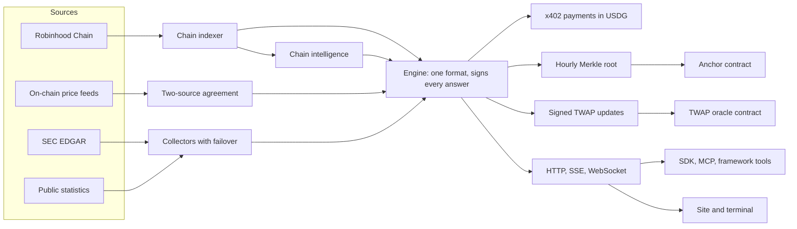

<p align="center">
  
</p>

<h1 align="center">Specula</h1>

<p align="center">
  <b>An open source data terminal for AI agents on Robinhood Chain.</b><br>
  An agent asks for exactly the data it needs, pays for that one answer from its own wallet, and gets it back signed,
  with where it came from and when it was collected.
</p>

<p align="center">
  <a href="https://speculaagents.fun">speculaagents.fun</a> ·
  <a href="https://speculaagents.fun/docs">Docs</a> ·
  <a href="https://speculaagents.fun/feeds">Feed catalog</a> ·
  <a href="https://speculaagents.fun/terminal">Terminal</a> ·
  <a href="https://x.com/SpeculaAgents">X</a>
</p>

<p align="center">
  
  
  
  
</p>

---

## Why Specula

Agents that trade, research or report need data they can trust, priced per question, without an account, a key or a
monthly plan. Specula is that layer for Robinhood Chain:

- **Robinhood Chain first.** New token launches, every DEX trade, holders, liquidity, burns, wallets and signals,
  indexed block by block from the chain itself.
- **Chain intelligence nobody else computes.** Who sniped a launch, a deployer's track record, wallet clusters and
  wallets that are early in tokens that later rose, each answer with the transactions and blocks behind it.
- **Prices you can check.** Every price is read from two independent sources and only answered when they agree.
- **An on-chain oracle.** A time-weighted price for Pons tokens that any contract can read, posted by anyone from the
  engine's signed updates, so it costs Specula no gas.
- **Pay per answer.** HTTP 402 with the exact price, a one-time USDG transfer signed by the agent's own wallet, settled
  only after the answer is ready. A failed answer is never charged.
- **Every answer signed.** Each answer carries the engine's signature and is sealed into an hourly Merkle root, so an
  agent can prove later exactly what it was told.

## The feeds

32 feeds in one format. Prices are per answer in USDG; the first answers every day are free for every wallet.

| Desk | Feeds | Read from |
|---|---|---|
| **The chain** | `chain.launches` `chain.trades` `chain.token` `chain.holders` `chain.liquidity` `chain.wallet` `chain.fees` `chain.price` `chain.prices` `chain.twap` | Robinhood Chain and its on-chain price feeds |
| **Chain intelligence** | `chain.snipers` `chain.deployer` `chain.clusters` `chain.smartmoney` | Specula's own index of the chain |
| **Companies** | `sec.filings` `sec.events` (8-K) `sec.insiders` (Form 4) `sec.holdings` (13F) `sec.fundamentals` `sec.facts` `sec.summary` | SEC EDGAR |
| **The economy** | `macro.series` `macro.snapshot` | The agencies that publish the statistics |
| **Signals** | `signals.recent` `signals.record` | The engine's rules over the data above, with a public track record |
| **Answers** | `answers.ask` `answers.briefing` | The feeds above, one citation per sentence |
| **Indexes** | `index.value` `index.history` | On-chain price feeds |
| **Archive** | `archive.at` `archive.range` | The engine's own archive of signed answers |
| **Lab** | `lab.backtest` | Prices the engine recorded |
| **Marketplace** | anything sellers list | Sellers' own endpoints, paid to the seller directly |

Only data that is free to serve: the chain, on-chain price feeds, public filings and public statistics. Nothing
scraped, paid or copyrighted.

## Five lines for an agent

```ts
import { Specula } from "@specula/sdk";
import { privateKeyToAccount } from "viem/accounts";

const specula = new Specula({ account: privateKeyToAccount(process.env.AGENT_KEY), maxPricePerCall: "0.05", budget: "2.00" });
const launches = await specula.launches({ limit: 5 });
const snipers = await specula.get("chain.snipers", { token: launches.data.launches[0].address });
```

The same feeds are available as an MCP server (`@specula/mcp`) for any MCP client, and as ready tools for the Vercel AI
SDK (`@specula/ai-sdk`), LangChain (`@specula/langchain`) and ElizaOS (`@specula/plugin-eliza`).

## How an answer is paid for

```
agent  ->  GET /v1/feeds/chain.price?symbol=NVDA
engine <-  402 Payment Required   { exact: 0.001 USDG, payTo, asset, network: eip155:4663 }
agent  ->  same request + X-PAYMENT (EIP-3009 transfer, signed by the agent's own wallet)
engine     checks the signature and price, collects the answer, then settles the transfer on chain
engine <-  200 OK   { data, source, collectedAt, proof: { engine, digest, signature } }
```

A payment counts only when the asset's own `Transfer` from the payer to the payee is in the transaction receipt. Each
signed transfer pays for one answer, once.

## Architecture



| Folder | What it is |
|---|---|
| `engine/` | TypeScript, Hono, SQLite. Collectors with failover, the chain indexer, chain intelligence, two-source price agreement, the TWAP oracle signer, x402 payments, signals, cited answers, the hourly Merkle seal, indexes, the marketplace, bounties, the archive, the strategy lab and teams. |
| `web/` | Next.js. The site, the feed catalog with runnable docs, the terminal, signals, ask, verify, indexes, status and roadmap. Every number on it comes from the engine. |
| `packages/` | `@specula/sdk`, `@specula/mcp`, `@specula/ai-sdk`, `@specula/langchain`, `@specula/plugin-eliza`, and three agent recipes. |
| `contracts/` | Solidity with Foundry: the hourly root anchor, the TWAP pull oracle, the bounty escrow and a mock dollar token for local tests. |
| `docs/` | Architecture, the deploy plan and the operations runbook. |

## Security model

- **Payments are proven, not assumed.** The payer is recovered from the signature itself, only the listed asset
  counts, and the asset's own `Transfer` must be in the receipt. Replays are refused.
- **The relayer cannot be drained.** Every relayed transaction is estimated first and capped per kind, with a daily
  budget and a per-payer share that survive restarts.
- **Outbound fetches are fenced.** Seller endpoints are https only, resolved once, checked against every private,
  internal and IPv4-in-IPv6 range, connected to the exact address that was checked, never redirected, and capped in
  size and time.
- **Private feeds stay private.** They never appear in status, search, streams, quotes, bounties or the archive.
- **The oracle is bound.** Updates are signed for one chain, one contract and one window, must be newer than the last,
  and a stale price cannot be read.
- **Limits everywhere it costs.** Request size, connection counts and per-address rates on expensive routes.

Found something? Please report it privately through GitHub security advisories on this repository.

## Run it

```sh
./dev.sh          # engine on :4100 reading the live chain (read only), site on :4200
./dev.sh --dev    # the same, with the site in development mode
./dev.sh --pay    # payments switched on against a local test chain and a mock dollar token
```

Then open http://localhost:4200. Nothing in any mode sends a transaction to a live network.

## Test it

```sh
npm run install:all
npm test          # contracts, engine, packages, site
```

| Suite | Tests |
|---|---|
| Contracts (Foundry), including attack tests on the oracle and the bounty escrow | 30 |
| Engine, including the security suite (payments, gas, fetch guard, private feeds) | 126 |
| SDK, MCP server and framework tools | 28 |
| Site smoke test: every route, copy rules, colours, empty states | 30 |

The tests need no network: chain data and public documents are replayed from recorded fixtures
(`engine/test/fixtures`, refreshed with `npm --prefix engine run record`), and payments run on a local chain.

## Status

- **Working and tested:** the engine and all 32 feeds, signing, failover, two-source agreement, the chain index and
  chain intelligence, pay per request (on a local chain), budgets, credits, receipts, streams, the SDK, the MCP server,
  the framework tools, signals with their record, cited answers, hourly Merkle roots, quality scores, indexes, the TWAP
  oracle, the marketplace with private feeds, the bounty board, the archive, the strategy lab, teams and the site.
- **Built, not switched on:** payments on the live chain (needs a payment address and a relayer key), a hosted model
  for summaries and answers, the anchor, oracle and bounty contracts (tested locally, not deployed), and the npm
  packages (not published).

## License

MIT. Specula is software, not financial advice; use at your own risk.
